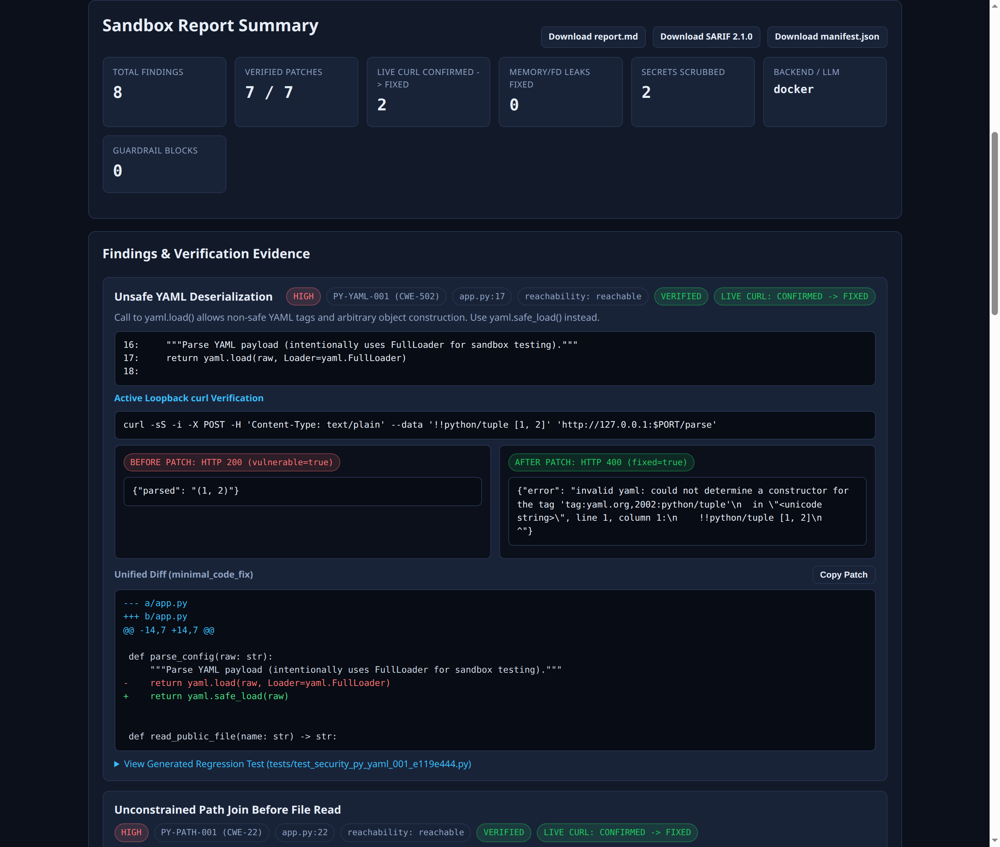

# VulnBox

Sandboxed security testing, **active before/after loopback `curl` verification**, and dual-verified patch remediation for Python and Node.js repositories—packaged as both a standalone CLI and a portable Agent Skill (`skills/vulnbox/`).

## Features

- **Zero-Mutation Secret-Scrubbed Sandbox**: Copies your repository to an ephemeral workspace, strips `.git/config`, and scrubs `.env`/keys/tokens before running anything—never mutating your working tree.
- **Pluggable Hardened Sandbox**: Runs inside hardened Docker containers (`--network=none`, `--cap-drop=ALL`, `--read-only`, `--security-opt=no-new-privileges:true`, non-root UID, CPU/RAM/PID caps) with an automatic isolated local fallback when Docker daemon is unavailable.
- **4-Layer Analysis**: Python AST SAST, Node.js SAST, Dockerfile/config/secret hygiene, and Dependency CVE reachability (`reachable` / `not_reachable` / `under_investigation`).
- **Active Before/After Loopback Verification (`curl`)**: Boots the target app on `127.0.0.1:<ephemeral_port>` inside the sandbox, runs a reproducible `curl` probe to prove the vulnerability exists live, applies the candidate fix, and re-runs the **exact same `curl` probe** to prove the fix works.
- **Dual-Verified Patching & Regression Tests**: Confirms SAST clean + active `curl` probe fixed + generated defensive regression test transitions `FAIL → PASS` + repo's existing test suite passes with zero regressions.
- **Optional Guarded LLM Mode (`--llm`)**: Synthesizes patches for complex findings via any OpenAI-compatible model (local Ollama, OpenAI, Gemini, vLLM) gated by deterministic guardrails and the sandbox truth oracle.
- **Standard Outputs**: Markdown report, verified `.patch` unified diffs, generated security regression tests, and schema-validated **SARIF 2.1.0** JSON.

## Quick Start

```bash
git clone https://github.com/YeshwanthUdayshankar/vulnbox.git
cd vulnbox
uv sync --extra dev

# Check environment & sandbox backends
uv run vulnbox doctor

# Profile a repository (read-only)
uv run vulnbox profile /path/to/repo

# Build the hardened Docker sandbox image
docker build -t vulnbox-sandbox:latest -f docker/sandbox.Dockerfile .

# Run end-to-end sandboxed scan, active curl probing, and dual-verified remediation
uv run vulnbox remediate /path/to/repo --backend docker --out ./vulnbox-out

# Verify a custom/agent-authored patch + custom loopback curl probe
uv run vulnbox verify-patch /path/to/repo --patch fix.patch --probe probe.json --backend docker

# Launch the local Web UI (all CLI capabilities in your browser at http://127.0.0.1:8787)
uv run vulnbox ui
```

## Local Web UI (`vulnbox ui`)

Start the zero-dependency local dashboard (`http://127.0.0.1:8787`) on any OS using the cross-platform startup scripts—all setup, virtual environments (`.venv/`), and package caches (`.vulnbox-cache/`) stay **100% local to the repository** with zero global or user-site installs:

| OS / Shell | Command |
| :--- | :--- |
| **Linux / macOS (Bash/Zsh)** | `./start-ui.sh` *(add `--port 8787`, `--no-browser`, or `--install`)* |
| **Windows (PowerShell / `pwsh`)** | `.\start-ui.ps1` |
| **Windows (Command Prompt / Double-Click)** | `start-ui.bat` |
| **Any OS (Direct Python)** | `python scripts/start_ui.py` *(or `uv run vulnbox ui`)* |

It exposes every CLI workflow—**Remediate** (with optional guarded `--llm`), **Scan**, **Profile**, **Active `curl` Probe**, and **Verify Custom Patch**—with one-click sample fixture loaders, side-by-side before/after `curl` proof, syntax-highlighted unified diffs, Guardrail Audit Trail tables, and downloadable `report.md` / `findings.sarif.json` / `manifest.json` bundles.

The UI server binds strictly to loopback (`127.0.0.1`), enforces a per-session CSRF token (`X-VulnBox-Token`) on all `POST /api/*` requests, validates `Host`/`Origin` headers, and sets strict `Content-Security-Policy` and `X-Frame-Options: DENY` headers.



See all UI screenshots (Dashboard + `--llm` controls, Remediation Diffs, and Active `curl` Probe tab) in **[docs/ui-guide.md](docs/ui-guide.md)**.

## End-to-End Sample Runs (Captured Docker Sandbox Output)

All three bundled sample repositories were tested end-to-end inside the hardened **`vulnbox-sandbox:latest`** Docker container (`--network=none`, `--cap-drop=ALL`, `--read-only`, non-root user). Full captured CLI output, before/after `curl` HTTP responses, unified diffs, regression test transitions, and Guardrail Audit Trails live under `docs/`:

| Sample Repo | Mode | Findings | Verified Patches | Live `curl` Confirmed → Fixed | Full Capture |
| :--- | :--- | :---: | :---: | :---: | :--- |
| [`tests/fixtures/py_sample_app`](tests/fixtures/py_sample_app) | Deterministic (`--backend docker`) | 8 | 7 / 7 | 2 (`PY-YAML-001`, `PY-PATH-001`) | [docs/sample-run-python.md](docs/sample-run-python.md) |
| [`tests/fixtures/node_sample_app`](tests/fixtures/node_sample_app) | Deterministic (`--backend docker`) | 5 | 5 / 5 | 2 (`JS-PATH-001`, `JS-CORS-001`) | [docs/sample-run-node.md](docs/sample-run-node.md) |
| [`tests/fixtures/llm_sql_app`](tests/fixtures/llm_sql_app) | Guarded LLM (`--llm` Ollama `qwen2.5:7b` + Docker) | 1 | 1 / 1 | 1 (`PY-SQL-001` + prompt-injection guardrail) | [docs/sample-run-llm-ollama.md](docs/sample-run-llm-ollama.md) |
| Public Benchmarks (`fastapi/full-stack-fastapi-template`, `OWASP/NodeGoat`) | Real-World Precision & Recall (`scan`) | 5 / 5 | — | Triage + Gap Analysis | [docs/benchmark-public-repos.md](docs/benchmark-public-repos.md) |

## Optional Guarded LLM Mode (`--llm`)

By default, `vulnbox` runs **100% deterministically** with zero LLM calls. For complex or custom findings that do not have a built-in rule-based auto-patch (such as custom SQL/command refactors or non-standard endpoints), opt into the **guarded LLM synthesis loop** using any OpenAI-compatible endpoint (local **Ollama**, **OpenAI**, **Gemini**, or **vLLM**):

```bash
# Local Ollama (no API key required)
uv run vulnbox remediate /path/to/repo --backend docker --llm --llm-provider ollama --llm-model qwen2.5:7b

# OpenAI or Gemini (OpenAI-compatible endpoint)
GEMINI_API_KEY=... uv run vulnbox remediate /path/to/repo --backend docker --llm --llm-provider gemini
OPENAI_API_KEY=... uv run vulnbox remediate /path/to/repo --backend docker --llm --llm-provider openai
```

### Deterministic Guardrails (Non-Negotiable)

Every LLM request and response passes through [`src/vulnbox/llm/guardrails.py`](src/vulnbox/llm/guardrails.py) before anything reaches the sandbox, and every decision is logged in the report's **Guardrail Audit Trail** (see live capture in [docs/sample-run-llm-ollama.md](docs/sample-run-llm-ollama.md)):

| Guardrail Gate | Enforcement |
| :--- | :--- |
| **Outbound Secret-Leakage Gate** | Blocks any outbound prompt containing unredacted credential patterns (`AKIA...`, `ghp_...`, `sk-...`, private keys) or exceeding prompt size budgets; only scrubbed sandbox copies are read. |
| **Prompt-Injection Framing & AST Dominance** | Wraps repository code in `<untrusted_repo_file>` XML delimiters (escaping tag breakouts), flags injection patterns in source comments, and never allows an LLM to downgrade or dismiss deterministic findings. |
| **Strict Structured JSON Output** | Requires a schema-validated `LLMPatchProposal` JSON object—the LLM never executes arbitrary shell commands. |
| **Diff Safety & Anti-Test-Tampering Gate** | Rejects path traversal (`..`), protected paths (`.git/`, `.github/`, `.env*`), modifications to existing test files, `pytest.mark.skip`/`# nosec` suppressions, dangerous sink re-introductions (`shell=True`, `eval`, `verify=False`, `0o777`), and excessive diff sizes. |
| **Loopback & Non-Destructive Probe Gate** | Confines LLM-proposed `DynamicProbeSpec` checks strictly to relative loopback paths (`127.0.0.1`), blocking external URLs, cloud metadata SSRF hosts (`169.254.169.254`), YAML RCE tags, shell metacharacters, and destructive SQL. |
| **Regression Test Safety Gate** | Restricts generated tests to `tests/test_security_*.py` or `tests/security_*.test.mjs`, validates Python AST syntax, and blocks subprocess/destructive/outbound-network calls. |
| **Sandbox Truth Oracle & Retry Budget** | Retries up to `--llm-max-retries` (default `2`) with sandbox failure feedback; an LLM patch is **never** marked `VERIFIED` unless `verify_patch()` passes all checks inside the isolated sandbox. |

## Output Bundle Structure

Every `vulnbox remediate` run writes a self-contained review bundle (without touching your target repo):

```text
vulnbox-out/
├── report.md                     # Executive summary, before/after curl proof, diffs, guardrail audit trail, HITL checklist
├── findings.sarif.json           # Schema-validated SARIF 2.1.0 report
├── manifest.json                 # Full machine-readable AuditReport (headers, excerpts, logs, guardrail events)
├── patches/
│   └── <finding_id>.patch        # Verified git-compatible unified diffs
└── regression_tests/
    └── test_security_<id>.py     # (or security_<id>.test.mjs) permanent defensive tests
```

## Python SDK & Plugin Extensibility

`VulnBoxEngine` (`src/vulnbox/engine.py`) is decoupled from the Typer CLI and backed by a central [`PluginRegistry`](src/vulnbox/registry.py) supporting both runtime registration and third-party `importlib.metadata` entry points (`vulnbox.plugins`):

```python
from vulnbox import AnalysisContext, VulnBoxEngine, default_registry

# Register custom analyzers, patchers, regression tests, probes, or reporters:
@default_registry.register_patcher("MY-RULE-001")
def patch_my_rule(finding, workspace_dir):
    ...

engine = VulnBoxEngine(backend="docker")
report, artifacts = engine.remediate("/path/to/repo", out_dir="./vulnbox-out")
```

To distribute a third-party language or rule pack (e.g., Go, Java, OSV, OpenVEX), advertise an entry point in your package's `pyproject.toml`:

```toml
[project.entry-points."vulnbox.plugins"]
my_pack = "my_vulnbox_pack:register"  # callable taking (registry: PluginRegistry) -> None
```

## Agent Skill

`vulnbox` ships as a portable Antigravity/Agent Skill at [`skills/vulnbox/SKILL.md`](skills/vulnbox/SKILL.md). To install it globally for Antigravity:

```bash
mkdir -p ~/.gemini/config/skills
ln -sfn "$(pwd)/skills/vulnbox" ~/.gemini/config/skills/vulnbox
```
