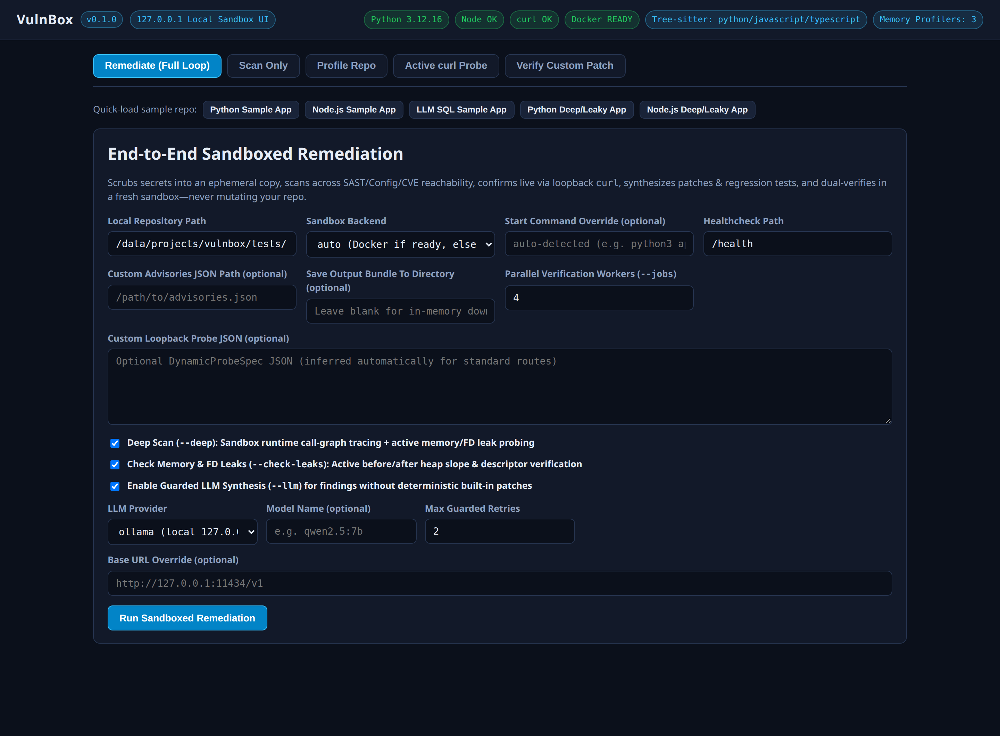
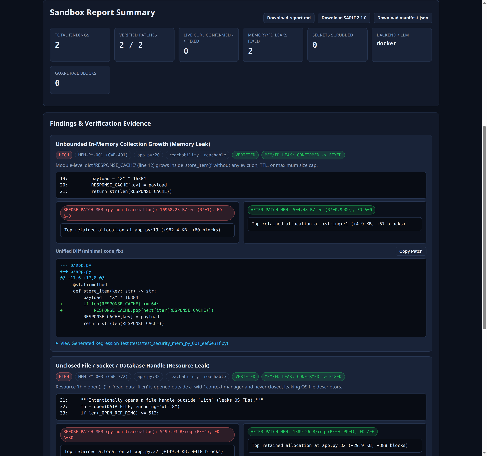
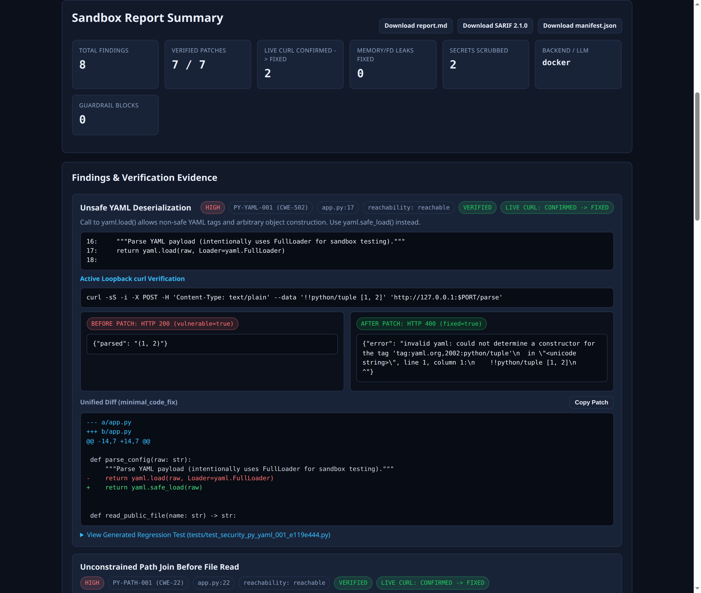
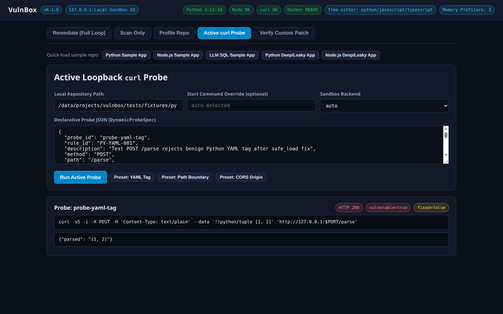

# VulnBox Local Web UI Guide (`vulnbox ui`)

Launch the zero-dependency local Web UI backed by `VulnBoxEngine` on **Linux, macOS, or Windows**:

| OS / Shell | Command |
| :--- | :--- |
| **Linux / macOS** | `./start-ui.sh` |
| **Windows (PowerShell / `pwsh`)** | `.\start-ui.ps1` |
| **Windows (CMD / Double-click)** | `start-ui.bat` |
| **Universal Python / `uv`** | `python scripts/start_ui.py` or `uv run vulnbox ui --port 8787` |

All launchers keep setup, `.venv/`, and `uv`/`pip` caches (`.vulnbox-cache/`) **strictly local to the repository** (setting `PIP_REQUIRE_VIRTUALENV=1`, `PIP_USER=0`, `PYTHONNOUSERSITE=1`, `UV_PROJECT_ENVIRONMENT=.venv`, and `UV_CACHE_DIR=.vulnbox-cache/uv`). They accept `--host`, `--port`, `--no-browser`, `--install` (force re-sync), `--no-install`, and `--dry-run`, and respect `VULNBOX_UI_HOST`, `VULNBOX_UI_PORT`, and `VULNBOX_NO_BROWSER`. Opens `http://127.0.0.1:8787` by default.

## 1. Dashboard Overview, Deep Scan (`--deep`), `--jobs`, & Guarded `--llm` Controls

The top environment doctor bar reports live readiness for Python, Node.js, `curl`, the hardened Docker sandbox, **Tree-sitter grammars** (`python/javascript/typescript`), and **pluggable Memory Profilers**. One-click sample buttons load bundled Python, Node.js, LLM SQL, and Deep/Leaky fixtures, alongside `--jobs` parallel workers, **Deep Scan (`--deep`)**, **Check Memory & FD Leaks (`--check-leaks`)**, and the optional **Guarded LLM Synthesis (`--llm`)** configuration panel.

---

## 2. Deep Scan: Hybrid Call Graph & Before/After Memory/FD Slope Verification

Enabling **Deep Scan (`--deep`)** + **Check Memory & FD Leaks (`--check-leaks`)** resolves dynamic `getattr()` / subscript dispatch gaps at runtime via Python 3.12 `sys.monitoring` and Node.js V8 Inspector, and runs active loopback heap & file-descriptor stress probes before and after applying each auto-patch—proving linear memory growth (`B/req`, $R^2$) and FD leaks (`FD Δ`) drop to flat steady-state after patching. If a host OS or runtime has no compatible memory profiler, the UI displays a non-fatal **`MEMORY PROBE SKIPPED`** badge without breaking verification.

---

## 3. Live Docker Remediation Results, Call-Path Reachability, Before/After `curl` Proof & Diff Viewer

After running end-to-end remediation inside the hardened Docker sandbox (`--network=none`), the UI displays executive KPI cards, downloadable `report.md` / `findings.sarif.json` / `manifest.json` artifacts, **Reachability Call Paths** (`entrypoint -> ... -> sink`), side-by-side **Before Patch vs. After Patch `curl` responses**, syntax-highlighted unified diffs with one-click copy, expandable generated regression tests, and the **Guardrail Audit Trail**.

---

## 4. Active Loopback `curl` Probe Runner

Test any custom or preset declarative `DynamicProbeSpec` JSON against a repository booted strictly on `127.0.0.1` inside the sandbox to actively reproduce vulnerabilities before authoring a patch.

---

## Built-In Web UI Security Controls

- **Loopback-Only Binding:** Binds strictly to `127.0.0.1` by default (refuses `0.0.0.0` unless explicitly overridden in code).
- **Per-Session CSRF Protection:** Every `POST /api/*` endpoint requires a random per-session `X-VulnBox-Token` header verified with constant-time comparison.
- **Host & Origin Validation:** Rejects cross-origin and non-loopback `Host`/`Origin` requests with `HTTP 403`.
- **Hardened HTTP Headers & XSS-Safe Rendering:** Sends strict `Content-Security-Policy` (`script-src 'self'; style-src 'self'` with zero `'unsafe-inline'`), `X-Frame-Options: DENY`, `X-Content-Type-Options: nosniff`, and `Referrer-Policy: no-referrer`, and renders all repository data via safe DOM `.textContent` nodes.
